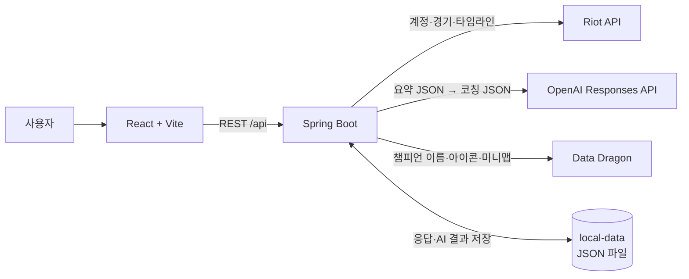

# 탑시야 (TopSiya) · AI 라인전 코치

> Riot ID만 입력하면 경기 타임라인을 자동으로 분석해서, **라인전에서 무엇이 꼬였고 다음 판엔 무엇 하나를 고치면 되는지** 알려주는 LoL 복기 서비스


---

## 1. 왜 만들었나

전적 사이트는 킬·데스·CS 같은 **결과**만 보여준다. "왜 졌는지", "다음엔 뭘 바꿔야 하는지"는 알려주지 않아서 같은 실수를 반복하게 된다.
유료 코칭은 부담스럽고, 리플레이를 직접 돌려보며 복기하기는 어렵다.

탑시야는 사용자가 아무것도 적지 않아도 **Riot API 타임라인(1분 단위 CS·골드·위치 + 킬·와드·포탑 이벤트)** 으로 라인전을 분석하고, AI가 그 결과를 코칭 문장으로 바꿔준다.

---

## 2. 핵심 기능

| 기능 | 내용 | AI 사용 |
|---|---|---|
| **경기 자동 분석** | 맞라인 상대를 찾아 5·10·15분 CS·골드 격차, 분당 CS 격차 그래프, 가장 크게 손해 본 3분 구간, 20분까지 데스(유형·위치·직전 와드), 포탑 방패, 1차 포탑을 계산 | 없음 (서버 계산) |
| **AI 코칭** | "다음 판엔 이것만" 한 문장 → 가장 큰 실수(시각·원인·고치는 법) → 잘한 점 | 데이터 해석·문장 작성 |
| **데스 미니맵** | 죽은 위치를 미니맵에 번호로 표시. 정글 갱·로밍 데스는 빨간색 | 없음 |
| **반복 실수 분석** | 같은 포지션 2~10판을 묶어 반복되는 습관 Top 3와 "다음 몇 판은 이것만" | 통계 해석 (1회 호출) |
| **상대 유형별 라인전** | 전사·탱커·마법사 등 상대 유형별 15분 CS 차이를 비교해 특히 약한 유형을 찾음 | 없음 |
| **목표 확인** | AI가 제안한 목표(예: 15분 전 와드 없이 죽은 횟수 0번)를 정하면, 이후 경기에서 지켰는지 **코드가** 판정 | 목표 지표 제안만 |

### 데스 유형 구분
| 유형 | 기준 |
|---|---|
| 라인 교전 | 라인 상대만 참여 |
| 정글 갱 | 상대 정글이 참여 |
| 상대 로밍 | 정글이 아닌 다른 라인 라이너가 참여 |
| 정글+로밍 | 둘 다 참여 |
| 한타 | 적 4명 이상 참여 |

로밍 데스는 "상대 라이너가 사라진 걸 놓친 문제", 정글 갱은 "정글 동선을 놓친 문제"라 코칭 내용이 달라서 구분한다.

---

## 3. 시스템 구조



### 처리 흐름
```
Riot ID 입력
  → ACCOUNT-V1 (PUUID) → MATCH-V5 (경기 ID, 상세, 타임라인)     ※ 경기 상세는 5개씩 동시에 받음
  → LaneAnalyzer: 맞라인 찾기, 격차·데스·포탑·와드 계산 → LaneReport (요약 JSON)
  → OpenAI: 요약 JSON + 지시문 → 코칭 JSON (Structured Outputs 로 형식 고정)
  → 검증: AI가 쓴 시각·숫자·데스 내용을 LaneReport 와 대조 → 틀리면 한 번 다시 쓰게 함
  → 파일에 저장 (같은 경기는 AI를 다시 부르지 않음)
```

### 기술 스택
| 구분 | 기술 |
|---|---|
| Frontend | React 18, Vite 5, Pretendard (폰트 내장) |
| Backend | Java 17, Spring Boot 3.5, RestClient, Jackson |
| 저장 | JSON 파일 (`backend/local-data`) — 끝난 경기 데이터는 바뀌지 않아서 DB 없이 파일 캐시로 충분 |
| 외부 API | Riot Games API (ACCOUNT-V1, MATCH-V5), OpenAI Responses API, Data Dragon |
| 테스트 | JUnit 5, Mockito, MockRestServiceServer |

---

## 4. AI 활용과 검증

### AI에게는 원본 대신 요약만 보낸다
타임라인 원본은 경기당 수천 줄이다. 서버가 먼저 라인전 요약(LaneReport)을 계산하고, AI는 **해석과 문장 작성만** 한다. 숫자 계산은 AI가 아니라 코드가 한다.

### 프롬프트 원칙
1. 데이터에 있는 수치·사건만 근거로 쓴다 (스킬 적중, 채팅, 아이템 등은 추측 금지)
2. 실수는 영향이 큰 순서로 1~3개, 각 실수에 시각·원인(수치 포함)·고치는 법
3. 로밍을 "갱"이라고 부르지 않는다
4. Structured Outputs(JSON Schema, strict)로 응답 형식을 고정한다

### AI가 지어낸 말 걸러내기
AI 답을 화면에 보여주기 전에 서버가 경기 기록과 대조한다.

| 검사 | 예 | 기준 |
|---|---|---|
| 시각 | "13:20에 죽었다" | 앞뒤 30초 안에 실제 데스·포탑 파괴가 있어야 함 |
| 시각 + 내용 | "13:20 **정글 갱**, **상대 진영**, 직전 와드 **0개**" | 그 시각 데스의 유형·위치·직전 와드 수와 같아야 함 |
| 이름 붙은 숫자 | "15분까지 와드 **12개**", "방패 **5개** 획득", "**3**데스", "CS 격차 **-5**" | 같은 종류의 데이터 값과 같아야 함 |

틀린 내용이 있으면 **무엇이 틀렸는지 알려주고 한 번 다시 쓰게** 한다. 사용자 화면에는 "✓ 실제 경기 기록과 대조한 내용이에요"만 짧게 보인다.

### 측정 결과 (실제 경기 10판, 개발자 화면)
| 항목 | 결과 |
|---|---|
| 사실 일치율 | 대조 항목 191개 중 **100%** 일치 |
| 검사기 시험 | 실제 AI 답에 틀린 내용 53개를 일부러 심음 → **53개 모두 적발** |
| 비교 | 시각만 보던 예전 검사였다면 53개 중 14개(26%)만 적발. 데스 유형·위치·와드 수·데스 수 오류는 하나도 못 잡음 |

검사기 시험은 "100%가 검사가 허술해서 나온 숫자가 아니다"를 확인하려고 만들었다. 단, 이 검사는 **사실이 맞는지**만 보고, 조언이 좋은지는 판단하지 않는다.

---

## 5. 실행 방법

### 준비물
- JDK 17 이상, Node.js 18 이상
- Riot API 키: [developer.riotgames.com](https://developer.riotgames.com) (개발용 키는 24시간마다 만료)
- OpenAI API 키

### 1) 키 설정
`backend/src/main/resources/application-secret.yml.example` 을 같은 폴더에 `application-secret.yml` 로 복사하고 키를 넣는다. 이 파일은 `.gitignore` 에 있어서 GitHub에 올라가지 않는다.

```yaml
riot:
  api-key: RGAPI-xxxxxxxx
openai:
  api-key: sk-xxxxxxxx
```

### 2) 백엔드 (http://localhost:8080)
```bash
cd backend
./gradlew bootRun        # Windows: .\gradlew bootRun
./gradlew test           # 테스트
```

### 3) 프론트엔드 (http://localhost:5173)
```bash
cd frontend
npm install
npm run dev
```

### 설정 옵션 (`application.yml` 의 `topsiya.*`)
| 설정 | 기본값 | 설명 |
|---|---|---|
| `data-dir` | `local-data` | Riot 응답·AI 결과 저장 폴더. 지우면 처음부터 다시 받는다 |
| `demo-mode` | `false` | `true` 면 외부 API를 부르지 않고 저장된 데이터로만 동작 (발표 시연용, 환경변수 `TOPSIYA_DEMO`) |
| `dev-tools` | `false` | `true` 면 개발자 화면(사실 일치율·검사기 시험)을 연다 (환경변수 `TOPSIYA_DEV_TOOLS`) |

**시연 준비:** 인터넷이 될 때 시연할 소환사를 검색하고 경기 분석·AI 코칭을 한 번씩 열어두면 모두 저장된다. 발표장에서는 `demo-mode: true` 로 켜면 인터넷이 없어도 같은 화면이 나온다.

---

## 6. API

| 메서드 | 경로 | 설명 |
|---|---|---|
| GET | `/api/summoners/{gameName}/{tagLine}/matches?count=10` | 최근 경기 목록 (최대 20) |
| GET | `/api/matches/{matchId}/lane?puuid=` | 라인전 분석 (LaneReport) |
| POST | `/api/matches/{matchId}/coach?puuid=` | AI 코칭 (검증 결과 포함) |
| POST | `/api/weaknesses` | 반복 실수 분석 `{puuid, position, matchIds}` |
| GET·PUT·DELETE | `/api/goals/{puuid}` | 도전 중인 목표 조회(판정 포함)·정하기·그만하기 |
| GET | `/api/ddragon/...` | 챔피언 이름·아이콘·미니맵 (서버가 받아서 저장) |
| GET | `/api/app-info` | `{devTools, demoMode}` |
| GET | `/api/eval`, `/api/eval/probe` | 사실 일치율, 검사기 시험 (dev-tools 일 때만) |
| POST | `/api/eval/run?puuid=&count=` | 최근 경기에 AI 코칭을 한꺼번에 돌려 측정 (dev-tools 일 때만, AI 비용 발생) |

---

## 7. 코드 구조

```
backend/src/main/java/com/topsiya
├── riot/      Riot API 호출 + 파일 캐시, 장애 시 저장본 사용, 데모 모드
├── match/     최근 경기 목록, 맞라인 상대 찾기
├── lane/      LaneAnalyzer: 타임라인 → 라인전 요약 (격차·데스 유형·포탑·와드)
├── coach/     AI 코칭, 프롬프트, 검증(CoachContextCheck), 검사기 시험(CoachProbe)
├── weakness/  여러 경기 통계 집계 + AI 해석
├── goal/      목표 지표(GoalMetric)와 판정
├── verify/    공통 검증(ClaimVerifier), 다시 쓰게 하기(CheckedAnswer), 측정
├── store/     JSON 파일 저장소
├── assets/    Data Dragon 대신 받기
└── common/    예외 처리, CORS, 병렬 호출

frontend/src
├── App.jsx                검색 → 목표 → 반복 실수 → 경기 목록
└── components/
    ├── LanePanel.jsx      경기 분석 (코칭, 숫자, 그래프, 데스 미니맵)
    ├── CoachCard.jsx      AI 코칭
    ├── WeaknessPanel.jsx  반복 실수 + MatchupTable(상대 유형별)
    ├── GoalPanel.jsx      도전 중인 목표
    └── EvalPage.jsx       개발자 화면
```

---

## 8. 한계

- Riot API는 미니언 위치를 주지 않아서 웨이브 관리는 CS 변화로만 추정한다.
- 위치는 1분 단위 스냅샷과 이벤트 시점 좌표뿐이라 세밀한 움직임은 알 수 없다.
- AI 검증은 **사실(시각·숫자·데스 내용)** 만 확인한다. 조언의 질은 사람이 판단해야 한다.
- 챔피언 이름은 AI는 한글, 데이터는 영어라 아직 대조하지 않는다.
- 상대 유형별 분석은 최근 경기 수가 적으면 비교가 어렵다.

---

## 9. 개발자
| 이름 | 역할 |
|---|---|
| 이지성 | 기획, 백엔드, 프론트엔드, AI 연동 (개인 프로젝트) |

*인공지능프로젝트 · 동양미래대학교 컴퓨터소프트웨어공학과*

---

*League of Legends 및 Riot Games는 Riot Games, Inc.의 상표입니다. 탑시야는 Riot Games가 보증하거나 후원하는 서비스가 아닙니다.*
