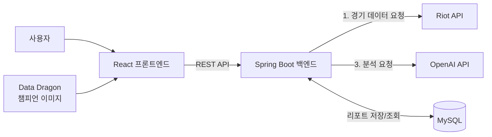

# 🎯 탑시야 (TopSiya)

> 소환사명만 입력하면, AI가 내 경기를 자동으로 분석해 라인전 코칭 리포트를 써주는 LoL 복기 서비스


---

## 1. 프로젝트 개요

### 해결하려는 문제
LoL 랭크 게임 유저는 라인전에서 진 이유를 스스로 분석하기 어렵다.
기존 전적 검색 사이트(OP.GG 등)는 킬/데스/CS 같은 **결과 수치**만 보여줄 뿐,
**"왜 그런 결과가 나왔는지"**, **"다음엔 무엇을 바꿔야 하는지"**는 알려주지 않는다.
그래서 같은 실수를 반복하면서 티어가 정체된다.

### 해결 방법
1. 사용자는 **소환사명(Riot ID)만 입력**한다.
2. 서버가 Riot API로 경기의 **분 단위 기록(CS·골드·위치)과 이벤트(킬·포탑 파괴·와드)**를 자동 수집한다.
3. 수집한 데이터에서 의미 있는 구간(격차가 급격히 벌어진 시점, 데스 직전 상황 등)을 추려낸다.
4. 생성형 AI가 이 데이터를 근거로 **실수 구간 → 원인 → 개선 방법**을 코칭 리포트로 작성한다.

### 예상 사용자
- LoL 랭크 게임 유저, 특히 실력 정체 구간(브론즈~플래티넘) 유저
- 코칭을 받고 싶지만 유료 코칭은 부담스러운 유저

### 활용 상황
- 랭크 게임이 끝난 직후 방금 경기를 복기하고 싶을 때
- 다음 게임 전, 내가 반복하는 실수를 확인하고 싶을 때

---

## 2. 핵심 기능

| # | 기능 | 설명 | AI 역할 |
|---|---|---|---|
| ① | 경기 자동 수집 | 소환사명으로 최근 경기 목록과 타임라인 데이터를 자동 수집 | 없음 (Riot API) |
| ② | AI 코칭 리포트 | 한 경기의 데이터를 분석해 실수 구간·원인·개선 팁을 생성 | 데이터 해석, 원인 추론, 코칭 문장 생성 |
| ③ | 반복 실수 패턴 요약 | 최근 여러 경기의 리포트를 종합해 반복되는 약점 Top 3 도출 | 여러 리포트 비교·종합 |

---

## 3. 시스템 구조



### 처리 흐름
```
[1] 소환사명 입력 (React)
      ↓
[2] Riot API 호출 (Spring Boot)
      ACCOUNT-V1  : Riot ID → PUUID
      MATCH-V5    : 최근 경기 ID 목록
      MATCH-V5    : 경기 상세 (챔피언, 포지션, KDA, 시야 점수 등)
      MATCH-V5    : 타임라인 (1분 단위 CS·골드·위치 + 이벤트 로그)
      ↓
[3] 데이터 가공 (Spring Boot)
      - 내 챔피언과 맞라인 상대 찾기
      - 분 단위 CS·골드 격차 계산 → 급변 구간 추출
      - 데스 직전 60초의 상황 정리 (상대 정글 위치, 내 위치, 와드 설치 여부)
      - AI 입력용 요약 JSON 생성
      ↓
[4] OpenAI API 호출 → 코칭 리포트(JSON) 생성
      ↓
[5] DB 저장 (같은 경기 재분석 방지, 기능③용 누적 데이터)
      ↓
[6] 리포트 화면 출력 (React)
```

### 기술 스택
| 구분 | 기술 |
|---|---|
| Frontend | React, Vite, Axios |
| Backend | Java 17, Spring Boot 3, Spring Data JPA, RestClient |
| Database | MySQL (개발 중에는 H2) |
| 외부 API | Riot Games API, OpenAI API, Data Dragon |
| 협업/배포 | GitHub |

---

## 4. AI 활용 방안

### AI가 하는 일
AI에게 원본 데이터를 통째로 주지 않는다. 40분 경기의 타임라인은 수천 줄이라 비용이 크고 분석 품질도 떨어진다.
**서버가 먼저 핵심 구간을 추려 요약 JSON을 만들고, AI는 그 요약을 해석해 코칭 문장을 작성**한다.

```json
{
  "myChampion": "다리우스",
  "opponent": "케넨",
  "result": "패배",
  "csDiff": { "10분": 15, "15분": -20 },
  "deaths": [
    {
      "time": "15:20",
      "killer": "상대 정글",
      "myPosition": "상대 포탑 근처",
      "enemyJunglerLastSeen": "1분 전 탑 강가",
      "myWardsLast2Min": 0
    }
  ]
}
```

### 프롬프트 설계 원칙
1. **역할 부여**: "너는 탑 라인 전문 코치다"
2. **근거 강제**: 모든 지적에 시간과 수치를 함께 쓰게 한다 (예: "15분 CS 격차 -20")
3. **추측 금지**: 데이터에 없는 내용(스킬 적중, 채팅 등)은 단정하지 않게 한다
4. **출력 형식 고정**: JSON으로만 응답하게 해서 화면에 그대로 표시한다

```json
{
  "summary": "경기 한 줄 요약",
  "mistakes": [
    { "time": "15:20", "what": "실수 내용", "why": "원인", "fix": "다음엔 이렇게" }
  ],
  "goodPoints": ["잘한 점"],
  "nextGameTip": "다음 경기에 기억할 한 가지"
}
```

### 비용·품질 관리
- 같은 경기는 한 번만 분석하고 DB에 저장해서 재사용
- 낮은 temperature로 같은 데이터에 비슷한 결과가 나오게 설정
- 실제 경기 10개로 리포트를 만들어, 지적 내용이 데이터와 맞는지 직접 검증

---

## 5. 화면 구성 (UI/UX)

| 화면 | 구성 |
|---|---|
| ① 검색 | 서비스 로고, Riot ID 입력창(닉네임#태그), 검색 버튼 |
| ② 경기 목록 | 최근 10경기 카드(챔피언 아이콘, 승패, KDA, 포지션), 탑 경기는 강조 표시, "분석하기" 버튼 |
| ③ 코칭 리포트 | 한 줄 요약, 분당 CS 격차 그래프, 실수 타임라인(시간·원인·개선), 잘한 점, 다음 경기 팁 |
| ④ 내 약점 | 최근 경기에서 반복된 약점 Top 3 |

- 분석에 수 초가 걸리므로 "경기 데이터를 불러오는 중 → AI가 분석하는 중" 단계별 로딩 표시
- 존재하지 않는 소환사명, 탑이 아닌 경기 등은 안내 메시지로 처리

---

## 6. 개발 일정

| 주차 | 기간 | 목표 |
|---|---|---|
| 1 | 10/13 ~ 10/19 | 개발 환경 세팅, Riot API 키 발급, 계정·경기 목록 조회 |
| 2 | 10/20 ~ 10/26 | (중간고사 주간) 경기 상세·타임라인 수집, DTO 정리 |
| 3 | 10/27 ~ 11/02 | 데이터 가공 로직, OpenAI 연동, 첫 코칭 리포트 생성 |
| 4 | 11/03 ~ 11/09 | React 화면 개발, 프론트-백엔드 연결, 프롬프트 튜닝 |
| 5 | 11/10 ~ 11/16 | 반복 패턴 요약, 예외 처리, 테스트, 발표 준비 |
| - | **11/17** | **프로젝트 발표** |

---

## 7. 실행 방법

### 준비물
- JDK 17 이상, Node.js 18 이상
- Riot API 키: [developer.riotgames.com](https://developer.riotgames.com) 로그인 → **DEVELOPMENT API KEY** 발급 (24시간마다 만료)

### 1) API 키 설정
`backend/src/main/resources/application-secret.yml.example`을 같은 폴더에 `application-secret.yml`로 복사하고 키를 넣는다.

```yaml
riot:
  api-key: RGAPI-xxxxxxxx
```

`application-secret.yml`은 `.gitignore`에 포함되어 GitHub에 올라가지 않는다. **API 키는 절대 코드에 직접 쓰지 않는다.**

### 2) 백엔드 실행 (http://localhost:8080)
```bash
cd backend
./gradlew bootRun        # Windows: gradlew.bat bootRun
```
IntelliJ에서는 `backend` 폴더를 열고 `TopsiyaApplication`을 실행해도 된다.

### 3) 프론트엔드 실행 (http://localhost:5173)
```bash
cd frontend
npm install
npm run dev
```

### 현재 구현된 API
| 메서드 | 경로 | 설명 |
|---|---|---|
| GET | `/api/summoners/{gameName}/{tagLine}/matches?count=10` | Riot ID로 최근 경기 목록 (최대 20개) |

---

## 8. 한계와 향후 계획
- Riot API는 미니언 위치를 제공하지 않아 웨이브 상태는 CS 변화로 **추정**한다.
- 위치 정보는 1분 단위라 세밀한 움직임 분석에는 한계가 있다.
- 향후: 탑 외 다른 포지션 지원, 장면 스크린샷 분석, 티어별 맞춤 코칭

---

## 9. 개발자
| 이름 | 역할 |
|---|---|
| 이지성 | 기획, 백엔드, 프론트엔드, AI 연동 (개인 프로젝트) |

*인공지능프로젝트 (동양미래대학교 컴퓨터소프트웨어공학과)*

---

*League of Legends 및 Riot Games는 Riot Games, Inc.의 상표입니다. 탑시야는 Riot Games가 보증하거나 후원하는 서비스가 아닙니다.*
